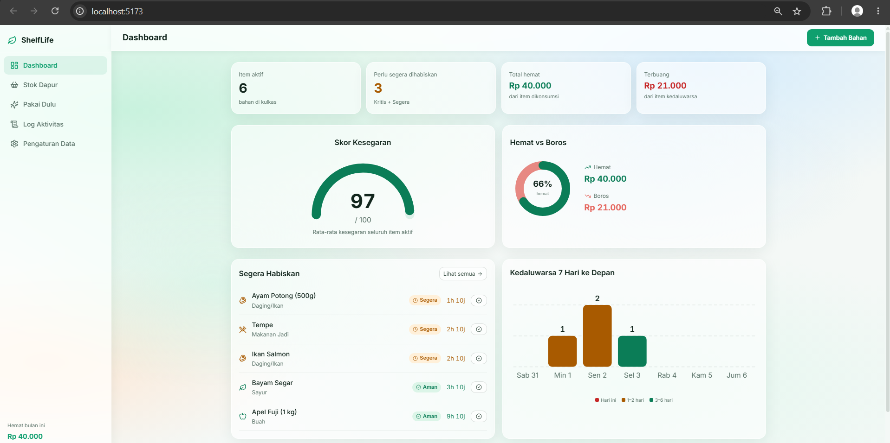
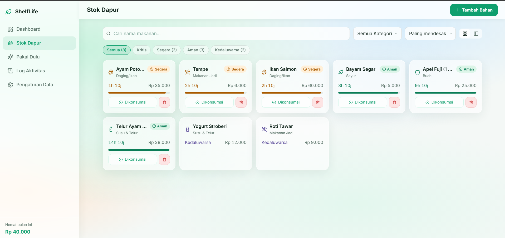
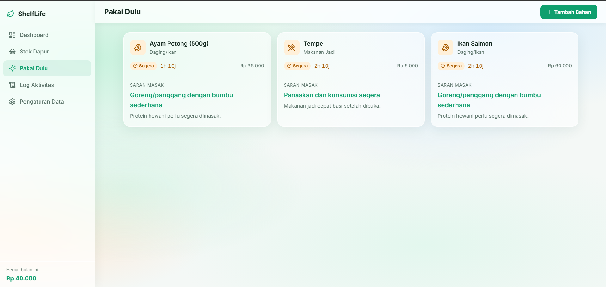
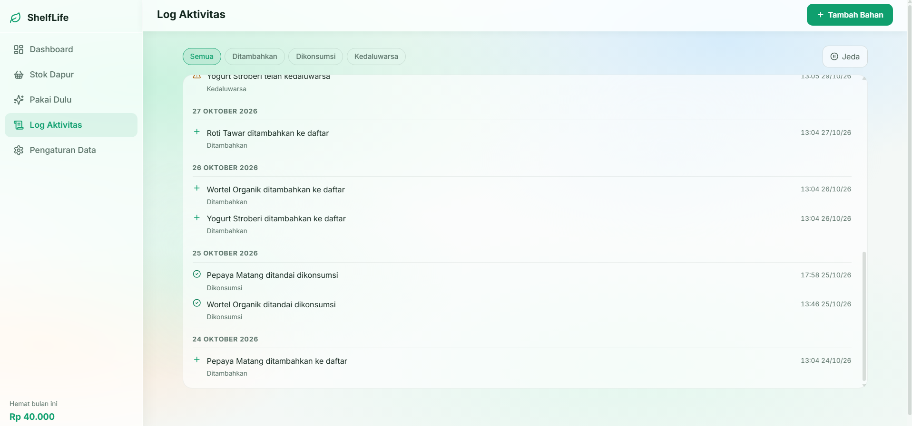
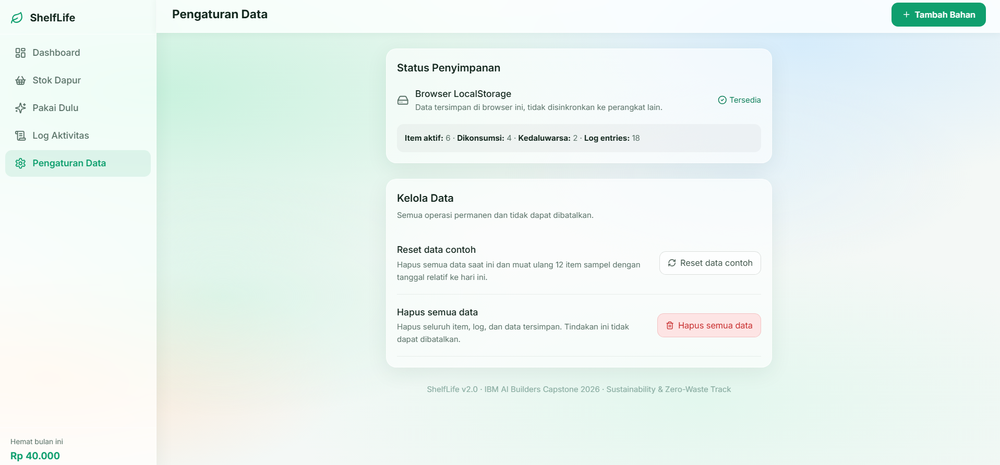

# ShelfLife – Smart Kitchen & Zero-Waste Dashboard

> Aplikasi web untuk membantu mahasiswa dan keluarga muda melacak tanggal kedaluwarsa bahan makanan serta memantau penghematan versus pemborosan.

---

## Fitur Utama

| Fitur | Keterangan |
|---|---|
| **Input Bahan Makanan** | Tambah nama, kategori, harga (Rp), dan tanggal kedaluwarsa dengan validasi inline |
| **Kartu Makanan + Hitung Mundur** | Tampilkan sisa waktu (hari/jam/menit), progress bar kesegaran, dan badge urgensi |
| **Telemetri Animasi** | Gauge SVG: Skor Kesegaran (0–100) & rasio Hemat vs Boros |
| **Log Aktivitas** | Catatan otomatis setiap item ditambahkan, dikonsumsi, atau kedaluwarsa (tanpa duplikasi) |
| **Saran "Pakai Dulu"** | 3 saran masak berbasis kategori item paling mendesak |
| **Data Contoh** | 10 item siap pakai agar dashboard langsung aktif |
| **Responsif** | Tampil optimal di HP hingga desktop (CSS Grid) |

---

## Cara Menjalankan

```bash
# 1. Masuk ke folder proyek
cd shelflife

# 2. Install dependensi
npm install

# 3. Jalankan server pengembangan
npm run dev
# Buka http://localhost:5173 di browser

# 4. Build untuk produksi
npm run build
# Output ada di folder dist/
```

**Kebutuhan sistem:** Node.js ≥ 18, npm ≥ 9

---

## Tech Stack

- **React 18** – UI library
- **Vite 5** – Build tool / dev server
- **Tailwind CSS 3** – Utility-first styling
- **Lucide React** – Icon library
- **Browser LocalStorage** – Persistensi data (tanpa backend)

---

## Rumus yang Digunakan

### 1. Urgency / Urgensi

```
msLeft = expiryDate - now  (dalam milidetik)

Kedaluwarsa : msLeft ≤ 0
Kritis      : 0 < msLeft ≤ 24 jam
Segera      : 24 jam < msLeft ≤ 72 jam
Aman        : msLeft > 72 jam
```

### 2. Skor Kesegaran (0–100)

```
Untuk setiap item aktif:
  ratio = clamp((expiryDate - now) / (expiryDate - addedAt), 0, 1)

Skor = rata-rata(ratio) × 100
```

Nilai 100 = semua item baru saja ditambahkan.  
Nilai 0 = semua item tepat di batas kedaluwarsa.

### 3. Gauge Hemat vs Boros

```
hemat = Σ harga item dengan status "consumed"
boros = Σ harga item dengan status "expired"
gauge = hemat / (hemat + boros)  ∈ [0, 1]

Kasus nol: jika hemat + boros = 0 → tampilkan "Belum ada data"
```

---

## Aturan Saran "Pakai Dulu" (Rule-Based, Bukan AI)

| Kategori | Saran |
|---|---|
| Sayur | Tumis atau sup sayur |
| Buah | Jus segar atau fruit salad |
| Daging/Ikan | Goreng/panggang dengan bumbu sederhana |
| Susu & Telur | Omelette atau susu hangat |
| Makanan Jadi | Panaskan dan konsumsi segera |
| Lainnya | Cek resep sederhana online |

---


- Tidak ada backend — semua data tersimpan di localStorage browser saja (per-device).
- Hitung mundur diperbarui setiap **60 detik** (bukan real-time per detik) untuk efisiensi.
- Saran masak bersifat generik (6 aturan kategori), bukan rekomendasi personal berbasis AI.
- Tidak ada sinkronisasi antar perangkat.
- Jika localStorage penuh atau dinonaktifkan, data tidak tersimpan (ada notifikasi di UI).
- Tanggal kedaluwarsa menggunakan **akhir hari (23:59:59)** pada zona waktu lokal browser.

---

## Tangkapan Layar






---

